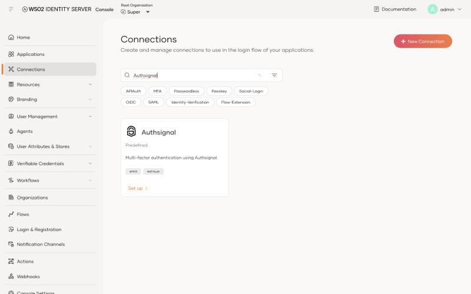
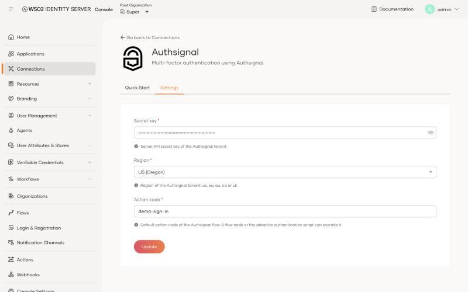
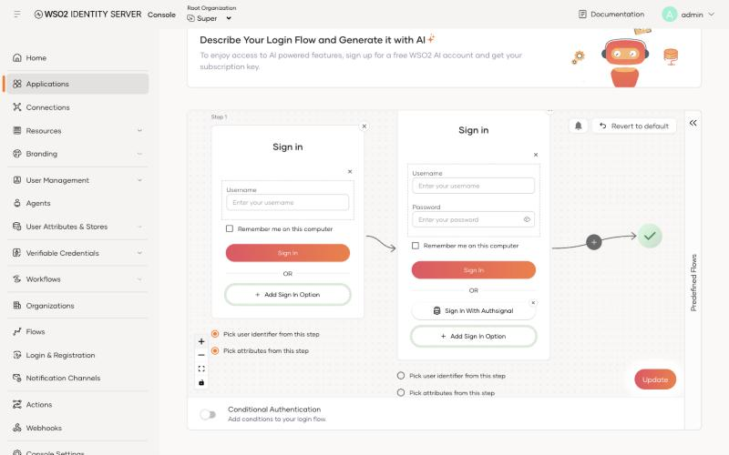
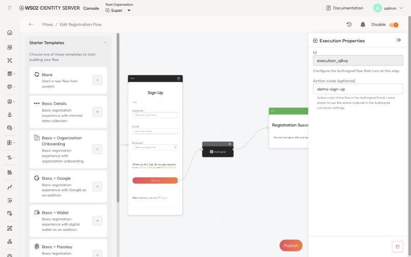
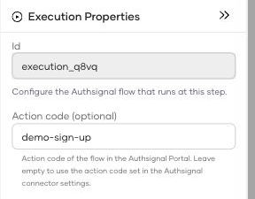

# Authsignal Authenticator for WSO2 Identity Server

A custom **local authenticator** that adds [Authsignal](https://www.authsignal.com) MFA to a self-hosted WSO2 Identity
Server login flow, plus a flow executor for registration and password recovery. Every journey uses
[Authsignal Flows](https://docs.authsignal.com/api-reference/server-api/start-flow): the connector starts the flow
configured for the journey in the Authsignal Portal, the user completes it in Authsignal's
[pre-built UI](https://docs.authsignal.com/implementation-options/prebuilt-ui/overview), and the connector verifies the
result server side.

The Authsignal user ID of a WSO2 user is the WSO2 user ID (UUID), which stays the same when the user is renamed.
Federated users use their subject identifier.

## How it works

```text
Step 1 (e.g. Username & Password) identifies the user
        │
        ▼
AuthsignalAuthenticator ── POST /v1/flows {actionCode, user: {userId}, redirectUrl} ──▶ Authsignal
        │                    redirectUrl = https://<is>/commonauth?sessionDataKey=<ctx>
        │
        └─ 302 to challengeUrl (Authsignal pre-built UI: passkey, TOTP, SMS, email OTP, …)
                                       │
                                       ▼
                     302 back to /commonauth?sessionDataKey=<ctx>&challenge_token=<token>
                                       │
AuthsignalAuthenticator ── POST /v1/flows/verify {actionCode, challengeToken} ──▶ Authsignal
        │
        └─ step completes only if action.state = CHALLENGE_SUCCEEDED and user.userId matches the user
           the flow was started for
```

The secret key never leaves the server. Matching `user.userId` binds the returned token to the user of this login. A
token for another user is rejected (ASIG-60008). A `challenge_token` parameter is ignored unless this login started a
flow. The rules and steps of each journey (whether to challenge, which methods to offer) are configured on the flow in
the Authsignal Portal.

## Build

Requires JDK 11+ and Maven 3.6+.

```bash
mvn clean install
```

The OSGi bundle is created at
`components/org.wso2.carbon.identity.local.auth.authsignal/target/org.wso2.carbon.identity.local.auth.authsignal-<version>.jar`.

## Deploy

1. Copy the JAR to `<IS_HOME>/repository/components/dropins/`.
2. Enable the authenticator by adding the following to `<IS_HOME>/repository/conf/deployment.toml`, then restart the
   server. Without it the authenticator is registered as disabled and is not listed in the Console. No parameters are
   needed: all other configuration is tenant-wise.

   ```toml
   [[authentication.custom_authenticator]]
   name = "authsignal-authenticator"
   ```
3. [Configure Authsignal](#configuration-tenant-wise) for each tenant.
4. [Add Authsignal to the login flow](#adding-authsignal-to-the-login-flow) of your applications, and optionally to the
   [registration and password recovery flows](#adding-authsignal-to-flows).

## Configuration (tenant-wise)

Each tenant (or Asgardeo organization) has its own Authsignal configuration.

1. In the Console, go to **Connections**. The **Authsignal** connection is listed once the connector is installed.

   

2. Open **Authsignal** and enter the Authsignal settings of the tenant, then click **Update**.

   

| Field | Default | Description |
|---|---|---|
| **Secret key** | – (required) | Authsignal Server API key (Authsignal Portal > Settings > API keys). |
| **Region** | `us` | Region of the Authsignal tenant: `us`, `eu`, `au`, `ca` or `uk`. Match it to the API Host shown in the Authsignal Portal. |
| **Action code** | `sign-in` | Default action code of the Authsignal flow, used in the login flow and in registration, invited-user registration and password recovery flows. It can be overridden [from the adaptive script](#optional-set-the-action-code-from-the-adaptive-script) and [per flow node](#adding-authsignal-to-flows). |

The Console screen is available in Console versions that include
[wso2/identity-apps#10903](https://github.com/wso2/identity-apps/pull/10903).

## Adding Authsignal to the login flow

Authsignal is used after an earlier step has identified the user. In the Console, open the application >
**Login Flow** and set up the steps as follows:

1. **Step 1:** Identifier First, which identifies the user.
2. **Step 2:** Username & Password, then **Add Sign In Option** > **Authsignal**.



Click **Update**. On sign-in, after entering the identifier the user can sign in with the password or choose **Sign In
With Authsignal**, which redirects them to Authsignal's pre-built UI to complete the Authsignal flow, and then back to
the application. Whether and how the user is challenged is decided by the
Authsignal flow, so most risk logic belongs in the Authsignal Portal rather than in the WSO2 login flow.

### Optional: set the action code from the adaptive script

By default the login flow uses the **Action code** of the tenant configuration. The adaptive authentication script of
an application can set a different action code by passing `actionCode` to the Authsignal step. For example, to use
the `step-up` flow for administrators:

```js
var onLoginRequest = function (context) {
    executeStep(1, {
        onSuccess: function (context) {
            var isAdmin = hasAnyOfTheRoles(context.currentKnownSubject, ["admin"]);
            executeStep(2, {
                authenticatorParams: {
                    local: {
                        "authsignal-authenticator": { actionCode: isAdmin ? "step-up" : "sign-in" }
                    }
                }
            }, {});
        }
    });
};
```

Each action code must match a flow configured in the Authsignal Portal.

## Adding Authsignal to flows

The bundle also registers the **Authsignal** executor (`AuthsignalExecutor`), which adds Authsignal to the flows built
in Console > **Flows**: self registration, invited-user registration and password recovery. It works with the hosted
portal (`/accounts`).

1. In the Authsignal Portal, configure the flow to use (by default, the one for the tenant's **Action code**).
2. In Console > **Flows**, open the flow and add the **Authsignal** node:
   - **Registration:** after the attribute collection form and **before** the user onboarding step. The form **must**
     collect the email address or the mobile number, as the Authsignal flow is started with it.
   - **Invited-user registration** and **password recovery:** after the user is identified and before the password
     step. In password recovery, keep Email OTP, SMS OTP or Magic Link as the recovery factor before the reset step and
     use Authsignal as an extra check.

   

3. Optionally, set **Action code** in the node's properties panel to use a different Authsignal flow for that node
   (for example, a `sign-up` flow for registration). Without it, the node uses the tenant's **Action code**.

   

   The property is stored as the `authsignalActionCode` metadata of the node's executor.

4. Save and publish the flow.

### Design decisions

- **Registration before the user exists.** The executor starts the Authsignal flow with the email address the user
  entered (or the mobile number when there is no email address). No user ID exists yet.
- **Contact details must be verified by the flow.** On return, a completed step of the flow must have verified the same
  email address (`EMAIL_OTP`, `EMAIL_MAGIC_LINK`) or phone number (`SMS`, `WHATSAPP`) the flow started with. A
  passkey-only flow does not count, and a token from another sign-up cannot be replayed.
- **Minimal state.** Only the `challengeId` of the verified flow is kept in the flow context; everything else is read
  again from the flow user and the node configuration.
- **Linking after the user is created.** Once registration creates the user, `AuthsignalFlowExecutionListener` calls
  Identify User, which moves everything enrolled in the flow to the user's Authsignal user ID. Registrations pending
  approval are not linked.
- **Verified claims come from matching authenticators only.** After a successful link, the email (or phone) verified
  claim is set only if the user has an Authsignal authenticator for the same email address (or mobile number). Contact
  details are never copied from Authsignal.
- **Pending link instead of failed registration.** Identify User is retried up to 3 times on network errors, 429 and
  5xx. If it still fails, the challenge ID is saved in the `http://wso2.org/claims/authsignalChallengeId` claim (add it
  as hidden and read-only) and the link is retried at the next sign-in, within the challenge's validity (10 minutes by
  default). Other errors drop the link, and the user has to enrol again.
- **Passkey status is tracked.** After every successful Authsignal flow, the
  `http://wso2.org/claims/identity/passkeyManagedExternally` claim is set to whether the user has a passkey on
  Authsignal. A failure to save it does not fail the flow or the login.
- **The `challenge_token` is required.** The token returned by Start Flow is invalidated as the user completes steps,
  so the executor verifies with the `challenge_token` Authsignal appends on return, which the portal must post back.
- **Password recovery accepts any successful flow of the user**, including one that enrols a new authenticator.
  Configure the Authsignal flow used for password recovery to only verify existing authenticators, using a separate
  action code if the default flow allows enrolment. Unknown users get a generic error.

## Keeping users in sync

This bundle does not sync profile changes or user deletions to Authsignal. The [Sync Service](sync-service/README.md)
in `sync-service/` does that: a Ballerina service deployed on Choreo that receives the IS 7.2+ (or Asgardeo) webhooks
**User profile updated** and **User deleted**, sets verified email and mobile changes on the Authsignal user, and
deletes the Authsignal user when the WSO2 user is deleted. Its README covers deployment and the webhook setup.

The reverse direction, Authsignal webhooks (authenticator added, changed or removed) written back into IS, is not
built yet.

## Troubleshooting

Enable debug logs in `<IS_HOME>/repository/conf/log4j2.properties`:

```properties
logger.authsignal.name = org.wso2.carbon.identity.local.auth.authsignal
logger.authsignal.level = DEBUG
```

The login authenticator reports these error codes:

| Error code | Meaning |
|---|---|
| ASIG-60001 | No user identified before the Authsignal step. Add a step that identifies the user before it. |
| ASIG-60002 | The tenant has not set the Authsignal secret key. |
| ASIG-60004 | The Authsignal user ID of the user could not be resolved. |
| ASIG-60005 / 60006 | Start Flow / Verify Flow failed. Check the tenant's secret key, region, flow action codes and network egress. |
| ASIG-60007 | The user failed or abandoned the flow. |
| ASIG-60008 | The challenge token does not belong to the user this flow started. |
| ASIG-60011 | The `challenge_token` is missing on return. |
| ASIG-60012 | The tenant's region is not one of `us`, `eu`, `au`, `ca`, `uk`. |
| ASIG-60013 | The tenant's Authsignal configuration could not be read. |

In registration and password recovery flows, errors are reported by the flow engine as `FE-65013` (server errors) or
`FE-60006` (user errors), with a description of the failure.

## Limitations / future work

- Second-factor only. Using it as a passwordless first factor would need an identifier-first step or the client-side
  passkey flow from [authsignal-wso2-authenticator](https://github.com/authsignal-examples/authsignal-wso2-authenticator).
- The secret key is masked in the Console and API responses but stored unencrypted with the tenant's resident IdP
  properties, as with other governance connectors. Encrypting it at rest would need WSO2's secret management service.
